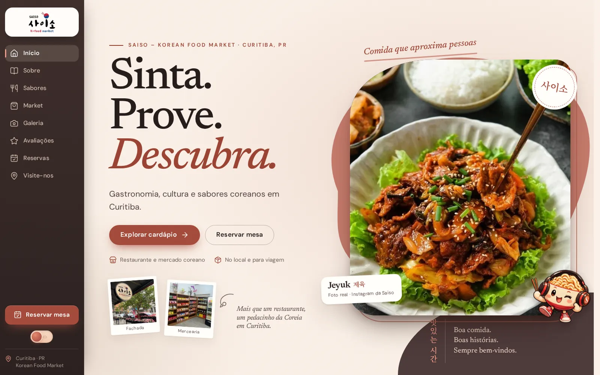

<p align="center">
  
</p>

<p align="center">
  
  
  
  
</p>

<p align="center">
  Demo de site para um restaurante e mercado coreano real do Centro de Curitiba, com cardápio lateral pesquisável, pratos em destaque, vitrine do K-market, galeria, reserva de mesa e mapa.
</p>

<p align="center">
  <a href="https://lorenzo-or7.github.io/saiso-demo/"><b>🔗 Acessar o site</b></a>
</p>

---

## 🖥️ Preview

<p align="center">
  <a href="https://lorenzo-or7.github.io/saiso-demo/"></a>
</p>

---

## 📌 Sobre o projeto

A Saiso é um restaurante e mercearia coreana no Centro de Curitiba: pratos como jeyuk, bibimbap e frango gochujang, e uma prateleira de bebidas e snacks importados. A proposta foi traduzir esse clima de "pedacinho da Coreia" para o site, com fotos reais da casa, cardápio fácil de explorar e reserva de mesa.

Tons de **terracota**, creme e cacau, serifa editorial (Newsreader) com DM Sans e detalhes em coreano (Noto Serif KR), polaroides e o mascote da casa.

---

## ✨ Funcionalidades

- 🧭 Navegação lateral no desktop e barra inferior no celular
- 🍲 "Sabores": oito pratos em destaque, um de cada vez
- 📋 Cardápio lateral com busca, categorias e detalhe do prato
- 🛒 Vitrine do K-market com filtros por tipo de bebida
- 🖼️ Galeria de fotos com lightbox
- ⭐ Avaliações de clientes
- 📅 Reserva de mesa com calendário (domingo fechado)
- 📍 Horários, mapa e informações de acessibilidade
- 🌗 Tema claro e escuro

---

## 🛠️ Tecnologias

- **HTML5** para a estrutura
- **CSS3** para identidade visual, responsividade e animações (com `prefers-reduced-motion`)
- **JavaScript** puro para as interações
- **GitHub Pages** para hospedagem

Site estático com fontes locais e imagens otimizadas em WebP na pasta `assets/`. Funciona offline; só o mapa do Google precisa de internet.

---

## ⚙️ Como rodar

Não precisa instalar nada: baixe o repositório e abra o arquivo `index.html` no navegador.

```bash
git clone https://github.com/lorenzo-or7/saiso-demo.git
```

> Este é um projeto demonstrativo: valores do cardápio, horários e itens do mercado são de referência e devem ser confirmados pelo estabelecimento.

---

## 👨‍💻 Autor

<p>
  Feito por <b>Lorenzo Orsetti</b><br/>
  <a href="https://lorenzo-or7.github.io">
    
  </a>
  <a href="https://www.linkedin.com/in/lorenzo-orsetti-031906349/">
    
  </a>
  <a href="https://github.com/lorenzo-or7">
    
  </a>
</p>

<p align="center">
  
</p>
